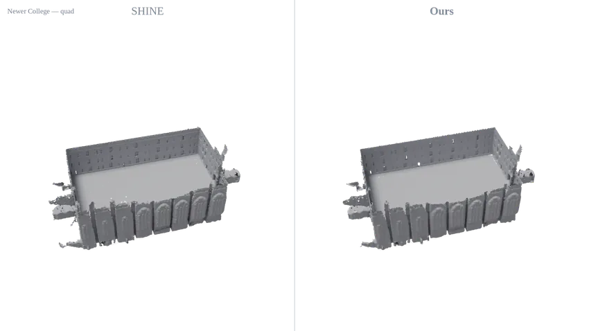
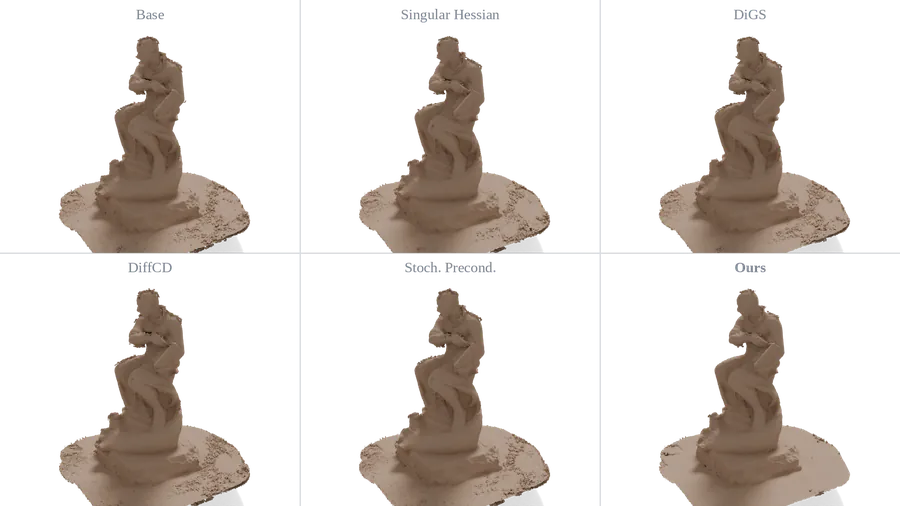
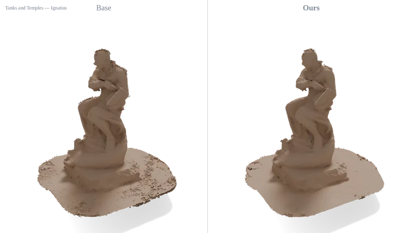
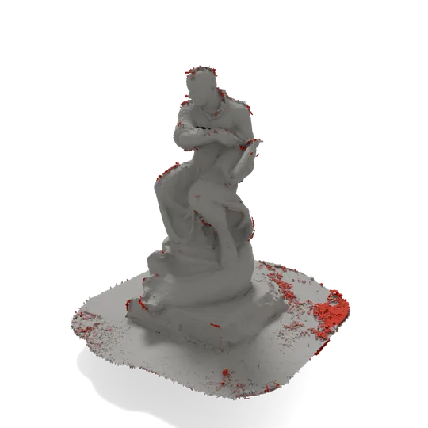
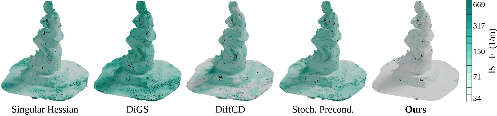
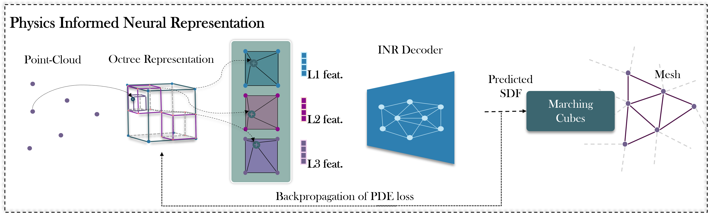

<div align="center">

<div id="user-content-toc">
  <ul align="center" style="list-style: none;">
    <summary>
      <h1>NIEO: Neural Implicit Energy Optimization for LiDAR Mapping</h1>
      <i>IEEE/CVF Winter Conference on Applications of Computer Vision (WACV) 2027</i>
    </summary>
  </ul>
</div>

<p>
Hrishikesh Viswanath<sup>1</sup> &emsp; Md Ashiqur Rahman<sup>1</sup> &emsp; Chi Lin<sup>1</sup> &emsp; Damon Conover<sup>2</sup> &emsp; Aniket Bera<sup>1</sup>
<br>
<sup>1</sup>Department of Computer Science, Purdue University &emsp; <sup>2</sup>DEVCOM Army Research Laboratory
</p>

<a href="https://arxiv.org/abs/2610.28598"></a> &emsp;
<a href="https://hrishikeshvish.github.io/nieo/"></a> &emsp;
<a href="https://www.python.org/"></a> &emsp;
<a href="https://pytorch.org/"></a> &emsp;
<a href="https://developer.nvidia.com/cuda-toolkit"></a> &emsp;
<a href="https://github.com/NVIDIAGameWorks/kaolin"></a> &emsp;
<a href="LICENSE"></a>

<br><br>

<br>
<em>Newer College (quad). Left: SHINE-Mapping. Right: the same octree and decoder trained with our curvature energy.</em>
<br><br>

<div id="toc">
  <ul align="center" style="list-style: none;">
    <summary>
      <h2><a href="#overview">Overview</a> &emsp; <a href="#data">Data</a> &emsp; <a href="#quick-start">Quick Start</a> &emsp; <a href="#running-the-baselines">Baselines</a> &emsp; <a href="#citation">Citation</a></h2>
    </summary>
  </ul>
</div>

</div>

---

## Overview

3D mapping of large-scale outdoor environments from LiDAR is a fundamental problem in vision and robotics. Neural implicit representations map surfaces memory-efficiently, but recovering high-fidelity geometry from sparse point clouds leaves them prone to geometric jitter and high-frequency artifacts. Classical geometry processing suppresses such artifacts with curvature energies whose minimizers are smooth surfaces.

**NIEO** casts LiDAR mapping as an energy optimization problem: we train a neural signed distance field while minimizing a variational curvature energy of its level set. The energy is the Frobenius norm of the **shape operator**

$$S = \frac{P\,\mathcal{H}(u)\,P}{\lVert \nabla u \rVert}, \qquad P = I - nn^\top, \qquad E_S(u) = \int_\Sigma \lVert S \rVert_F \, dA,$$

whose eigenvalues are the principal curvatures, so $\lVert S\rVert_F^2 = \kappa_1^2 + \kappa_2^2$. It penalizes genuine bending of the surface, not the normal-direction curvature and gradient-norm drift that a raw Hessian penalty also charges for. A gradient–Hessian alignment term covers exactly that complementary block, and a minimal-surface term penalizes spurious area. The method scales to million-point LiDAR sweeps over open surfaces spanning hundreds of metres, and adds **no cost at inference time**: it changes only the training objective.

### Highlights

- **Drop-in regularizer** for octree-feature neural SDFs (built on [SHINE-Mapping](https://github.com/PRBonn/SHINE_mapping)). The architecture, sampler and inference are unchanged.
- **Curvature, not roughness.** The intrinsic surface energy and the alignment term are exact Frobenius-orthogonal pieces of the Hessian, so they never double-count.
- **Eight prior regularizers in one codebase**: RegSDF, NeuralSSD, GradHess, Neural-Singular-Hessian, DiGS, SIREN, DiffCD and Stochastic Preconditioning. They share the same octree, decoder and sampler, so only the regularizer differs.
- **Eight scenes, three sensing modalities**: LiDAR (Newer College, MaiCity), MVS-derived point clouds (Tanks and Temples: Truck, Ignatius, Caterpillar, Barn, Courthouse) and indoor RGB-D (Redwood).
- **Mesh *and* field metrics**: exact point-to-surface accuracy/completeness, F-score, normal consistency, Chamfer angle, plus Dirichlet/Hessian energy and shape-operator norm measured on the SDF itself.
- **One command per experiment.** Every config that produced a number in the paper is shipped as-is.

---

## Results

<div align="center">

<br>
<em>Tanks and Temples, Ignatius: Base and the compared regularizers against ours.</em>
<br><br>

<table>
<tr>
<td align="center"><br><em>Base vs. ours</em></td>
<td align="center"><br><em>Base morphing onto ours; red marks where the surfaces disagree most</em></td>
</tr>
</table>


<br>
<em>Level-set curvature ‖S‖<sub>F</sub> on the reconstructed surface, all methods on one colour scale.</em>
</div>

Quantitative results for every scene are in the paper.

---

## Method

<div align="center">

</div>

Points are encoded by a sparse multi-resolution feature octree and decoded to a signed distance by a small MLP, as in SHINE-Mapping. Training minimizes

$$\mathcal{L} = \lambda_1 \mathcal{L}_{\text{bce}} + \lambda_2 \mathcal{L}_{\text{Eikonal}} + \lambda_S E_S + \lambda_A E_A + \lambda_M E_M,$$

where $E_S$ is the shape-operator energy above, $E_A$ aligns the gradient with the Hessian (pinning $\lVert\nabla u\rVert$ locally constant, which $E_S$ alone cannot do), and $E_M$ is a minimal-surface area term. The weights $\lambda_S, \lambda_A$ are set per scene from the magnitude of each term on a trained base field (`ours.yaml` in each config folder).

---

## Repository Structure

```
nieo/
├── train.py                  # training entry point (one YAML config per run)
├── model/                    # feature octree + SDF decoder
├── utils/
│   ├── loss.py               # our energy and all eight baseline regularizers
│   ├── config.py             # every config key and its default
│   └── mesher.py             # marching cubes over the octree
├── dataset/                  # loader + converters (Tanks and Temples MVS, Redwood RGB-D)
├── eval/                     # mesh metrics, field metrics, post-hoc mesh extraction
├── config/<dataset>/<method>.yaml   # the exact config behind each paper result
├── scripts/                  # download / prepare / train / evaluate / run_baselines
└── tests/                    # unit checks for the regularizers
```

---

## Installation

Tested on Ubuntu with Python 3.11, PyTorch 2.8 and CUDA 12.9. Install PyTorch and Kaolin first, since both need wheels that match your CUDA version.

**1. Environment**
```bash
git clone https://github.com/HrishikeshVish/nieo.git
cd nieo
conda create -n nieo python=3.11 -y
conda activate nieo
```

**2. PyTorch** (replace `cu129` with your CUDA version, e.g. `cu128`, `cu126`)
```bash
pip install torch==2.8.0 --index-url https://download.pytorch.org/whl/cu129
```

**3. Kaolin** (the wheel index must match the PyTorch and CUDA versions above)
```bash
pip install kaolin==0.18.0 -f https://nvidia-kaolin.s3.us-east-2.amazonaws.com/torch-2.8.0_cu129.html
```

**4. Everything else**
```bash
pip install -r requirements.txt
```

**5. Check the install**
```bash
python tests/test_regularizers.py
```

> [!NOTE]
> Tanks and Temples preparation also needs a **CUDA build of COLMAP** for dense multi-view stereo. `scripts/prepare_tanksandtemples.sh` sets one up automatically on first use (pycolmap if your wheel has CUDA, otherwise COLMAP from conda-forge in a separate `colmap` env).

---

## Data

All data goes under `data/`. Configs use repo-relative paths, so run every command from the repository root.

| Dataset | Type | Get it | Prepare |
| :--- | :--- | :--- | :--- |
| Newer College (quad) | LiDAR | `bash scripts/download_data.sh ncd` | – |
| MaiCity (seq. 01) | LiDAR, synthetic | `bash scripts/download_data.sh maicity` | – |
| KITTI 00 (100 frames) | LiDAR, smoke test only (no configs shipped) | `bash scripts/download_data.sh kitti` | – |
| Tanks and Temples (Truck, Ignatius, Caterpillar, Barn, Courthouse) | MVS from images | `bash scripts/download_data.sh tanksandtemples truck ...` | `bash scripts/prepare_tanksandtemples.sh <scene>` |
| Redwood (bedroom) | indoor RGB-D | manual, see `bash scripts/download_data.sh redwood` | `bash scripts/prepare_redwood.sh` |

<details>
<summary><b>Notes on Tanks and Temples and Redwood</b></summary>

- **Tanks and Temples** provides images, not point clouds. We run COLMAP dense MVS with T&T's *published* camera trajectory, rather than our own SfM, so the reconstruction stays in the frame of T&T's ground-truth alignment. We then back-project each depth map into one "scan" per image. All five scenes use `fx = 1156 px`: they were shot with the same body and lens, and T&T's generic `0.7·W` guess is about 16% off, which corrupts the depth maps. The ground-truth bundle (`<Scene>.ply`, `.json`, `_trans.txt`, `_COLMAP_SfM.log`) sits in a Google Drive folder that may need a browser login; the downloader prints the manual fallback.
- **Redwood**'s laser-scan ground truth and RGB-D trajectory are independent recordings. `prepare_redwood.sh` applies the alignment used in the paper (`dataset/redwood_bedroom_gt_registration.txt`, 2.4 cm median residual). Set `REGISTER=1` to re-estimate it.
- The loader pairs scans with poses **by sorted list position**, so a missing frame shifts every pose after it. The prepare scripts check that the counts match.

</details>

---

## Quick Start

```bash
bash scripts/download_data.sh ncd
bash scripts/train.sh ncd ours          # train   -> experiments/ncd_ours_<timestamp>/
bash scripts/evaluate.sh ncd ours       # mesh + metrics -> experiments/evaluation/
```

`train.sh <dataset> <method> [gpu]` runs `python train.py config/<dataset>/<method>.yaml`, so you can also call `train.py` directly with any config.

`evaluate.sh` extracts a mesh from the newest checkpoint at the resolution used in the paper. It then writes two CSVs: mesh metrics against ground truth, and field metrics computed on the SDF.

---

## Running the Baselines

```bash
# every method that has a config for this dataset: train, mesh, evaluate
bash scripts/run_baselines.sh truck

# a subset, on GPU 1
bash scripts/run_baselines.sh truck 1 base ours regsdf digs

# train only
SKIP_EVAL=1 bash scripts/run_baselines.sh ignatius
```

Logs go to `experiments/logs/<dataset>_<method>.log`. A failed run is reported and the loop moves on to the next method.

| `<method>` | Regularizer | Reference |
| :--- | :--- | :--- |
| `base` | none (SHINE-Mapping) | Zhong et al., ICRA 2023 |
| `ours` | shape-operator energy + gradient–Hessian alignment + minimal surface | this work |
| `regsdf` | L1 Hessian + minimal surface | Zhang et al., *Critical Regularizations for Neural Surface Reconstruction in the Wild*, CVPR 2022 |
| `neuralssd` | Frobenius Hessian + normal alignment | Xi et al., *NeuralSSD*, 2025 |
| `gradhess` | gradient–Hessian alignment (SIREN) | Wang et al., *Aligning Gradient and Hessian for Neural SDF*, NeurIPS 2023 |
| `singular_hessian` | singular Hessian + relaxed eikonal (SIREN) | Wang et al., *Neural-Singular-Hessian*, TOG 2023 |
| `digs` | divergence (SIREN) | Ben-Shabat et al., *DiGS*, CVPR 2022 |
| `siren` | off-surface penalty (SIREN) | Sitzmann et al., *SIREN*, NeurIPS 2020 |
| `diffcd` | symmetric differentiable Chamfer | Härenstam-Nielsen et al., *DiffCD*, ECCV 2024 |
| `stoch_precond` | stochastic input preconditioning | Ling et al., *Stochastic Preconditioning*, TOG 2025 |

Methods marked SIREN use a sine-activated decoder, as their papers prescribe; every other method keeps the ReLU decoder. Each regularizer is a set of flags in the `loss:` block (see `utils/config.py` for all keys), so to try one on your own data, copy that method's YAML and change `setting:`.

**Shipped configs** (the exact settings behind the paper's numbers, including per-scene iteration budgets):

| | NCD | MaiCity | Truck | Ignatius | Caterpillar | Barn | Courthouse | Redwood |
| :--- | :-: | :-: | :-: | :-: | :-: | :-: | :-: | :-: |
| `base`, `ours` | ✓ | ✓ | ✓ | ✓ | ✓ | ✓ | ✓ | ✓ |
| `neuralssd`, `singular_hessian`, `digs`, `diffcd`, `stoch_precond` | | | ✓ | ✓ | ✓ | ✓ | ✓ | ✓ |
| `regsdf`, `gradhess`, `siren` | | | ✓ | ✓ | | | | ✓ |

---

## Evaluation

| Script | Measures | Needs |
| :--- | :--- | :--- |
| `eval/eval_run.py` | accuracy, completeness, Chamfer-L1, precision/recall/F-score; exact point-to-triangle recall; with `--with_normals`, normal consistency, Chamfer angle and normal-augmented F-score | mesh |
| `eval/field_metrics.py` | Dirichlet energy, L1/L2 Hessian energy, shape-operator norm, gradient-norm statistics, sampled inside the occupied octree | checkpoint |
| `eval/reconstruct_mesh.py` | marching cubes from a checkpoint at any resolution (tiled for city-scale maps) | checkpoint |
| `eval/clean_mesh.py` | keep the largest connected component(s) | mesh |

Ground-truth paths and thresholds for each dataset are in `DATASETS` at the top of `eval/eval_run.py`. Tanks and Temples uses the official per-scene τ and crop volume.

---

## Citation

```bibtex
@article{viswanath2026neural,
  title={Neural Implicit Energy Optimization for LiDAR Mapping},
  author={Viswanath, Hrishikesh and Rahman, Md Ashiqur and Lin, Chi and Conover, Damon and Bera, Aniket},
  journal={arXiv preprint arXiv:2610.28598},
  year={2026}
}
```

## Acknowledgments

This codebase builds on [SHINE-Mapping](https://github.com/PRBonn/SHINE_mapping) by Zhong, Pan, Behley and Stachniss (MIT license); the octree, decoder and sampler come from it. The baseline regularizers re-implement the methods cited above within this framework, following each paper. Datasets: [Newer College](https://ori-drs.github.io/newer-college-dataset/), [MaiCity](https://www.ipb.uni-bonn.de/data/mai-city-dataset/), [KITTI](https://www.cvlibs.net/datasets/kitti/), [Tanks and Temples](https://www.tanksandtemples.org/), [Redwood](http://redwood-data.org/indoor_lidar_rgbd/).

## License

MIT. See [LICENSE](LICENSE).
